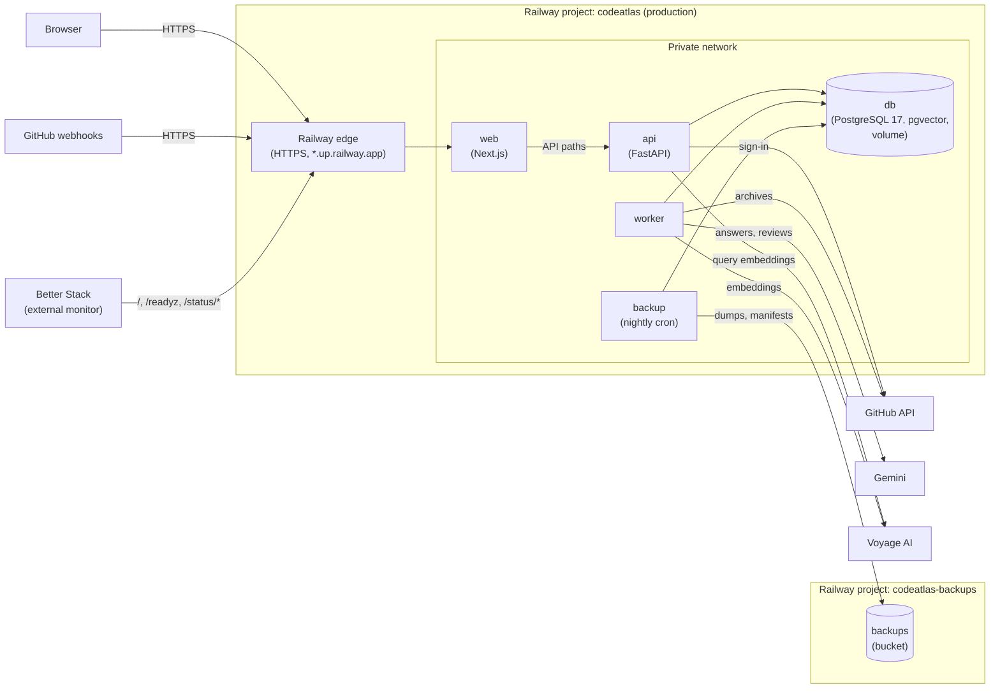

# CodeAtlas

CodeAtlas answers questions about a GitHub repository and reviews its pull requests, citing its
evidence. Every claim in an answer points to exact file and line ranges at the indexed commit, and
a question the code does not answer gets an "insufficient evidence" result instead of a guess.

CodeAtlas runs as an invitation-only pilot at a public HTTPS address on Railway. Every service runs
from the repository's Dockerfiles, every commit merged into `main` is released once CI passes and
takes traffic only after its readiness check, an external monitor and Railway's notifications send
alerts by email, and the database is backed up every night to a private bucket in a separate
Railway project (see [Deployment](#deployment)).

A short demo recording from the pilot will appear here once the pilot runs.

## What it does

- **Connect repositories** through a read-only GitHub App. Indexing runs in the background with
  visible progress and reports every skipped file with its reason (generated, binary, credential
  file, too large, and so on).
- **Stay current**: a push to a connected repository's default branch is indexed automatically,
  and a daily check catches pushes whose notification was missed.
- **Ask questions** about an indexed commit. Answers separate facts from inferences, and each
  citation opens the cited lines in the file browser.
- **Browse and search** the indexed commit: a file tree, file views, and text, path, symbol, and
  documentation search.
- **Review pull requests** on request: a summary of the change, risks ranked by severity with an
  overall risk level, a checklist for the human reviewer, and test suggestions. Every item cites
  the changed lines or related code on the correct side of the change, the review is pinned to
  the base, head, and merge-base commits, and it shows when new commits make it outdated. A review
  can be copied as Markdown; CodeAtlas never posts it to GitHub.
- **Stay contained**: each user has a private workspace, questions and reviews have daily
  allowances, and disconnecting a repository hides its data at once and purges it within 24 hours.
  When the owner loses access on GitHub, CodeAtlas stops serving the repository at once, and purges
  it unless access returns within 7 days. CodeAtlas never writes to GitHub and never executes
  repository code.
- **Admit only invited users**: in the pilot, only GitHub accounts on the access list (at most 10)
  can sign in. Anyone else sees an invitation page, and CodeAtlas keeps only an audit record of the
  denied sign-in. Pilot-wide daily limits on questions and reviews cap model spend, and sign-in and
  webhook requests are rate-limited per network address.

## Architecture

- **Frontend** (`frontend/`): Next.js, React, and TypeScript, with an API client generated from
  the API's OpenAPI document. The web app and the API share one origin.
- **API** (`backend/src/codeatlas/api`): FastAPI. It owns sign-in, authorization, workspace
  scoping, job creation, browsing, and search.
- **Worker** (`backend/src/codeatlas/jobs`): a Python process sharing the API's package. It
  downloads commit tarballs, extracts Python and TypeScript declarations with tree-sitter, builds
  the search indexes, generates answers, and reviews pull requests by diffing the merge-base and
  head archives.
- **PostgreSQL** with pgvector and pg_trgm is the only data store. It holds records, file
  contents, trigram and full-text search, documentation embeddings, and the job queue (claimed
  with `FOR UPDATE SKIP LOCKED`, with leases and fencing tokens).
- **GitHub App**: one App provides sign-in, read-only repository and pull request access, and
  webhook notifications of pushes and installation changes, verified by their HMAC signature.
- **Model providers**: Gemini 3.8 Flash generates answers and reviews in the worker from a bounded
  set of evidence as structured JSON, and the server validates every citation. Voyage AI embeds
  documentation during indexing and search queries in the API.

The deployed pilot ([Deployment](#deployment)):



## Deployment

The pilot runs on Railway (Hobby plan, US East), built from the repository's Dockerfiles, with one
replica of each service.

- **Services**: `web` (Next.js) is the only service with a public address, Railway's
  `*.up.railway.app` domain for it. `api` (FastAPI), `worker`, and `backup`, a nightly cron job,
  share the backend image; `db` is PostgreSQL 17 with pgvector on a volume. The web app forwards
  the API's paths over Railway's private network, so the browser, GitHub's webhooks, and the
  sign-in callback use one origin; `api`, `worker`, `backup`, and `db` have no public address.
- **Edge**: Railway's edge serves HTTPS with a certificate it renews, redirects HTTP to HTTPS, and
  reports the client address that the API's rate limit counts.
- **Configuration**: `.railway/railway.ts` records the services, their commands, healthchecks,
  sizes, and schedule, and the names of their variables. The developer previews each change with
  `railway config plan` and applies it with `railway config apply`. Secrets are sealed variables
  on the services that use them; the repository, the images, and CI hold no credentials.
- **Releases**: every commit merged into `main` is released once CI passes ("Wait for CI").
  `api` migrates the database before its new version starts, skipping when the database is ahead
  so that rollbacks work, and takes traffic only after its readiness check passes. `web`,
  `worker`, and `backup` wait until `api` reports their commit, so a failed migration or readiness
  check stops the whole release while the previous version keeps serving. Rollback is one action
  per service. CI lists every schema change on pull requests, for review before the merge.
- **Monitoring**: Railway keeps every service's logs, searchable by their JSON fields, and its
  metrics, and emails failed builds, failed deployments, crashes, and spending thresholds. Better
  Stack checks the public address, readiness, and four status endpoints (the worker's heartbeat,
  waiting jobs, failing jobs, and backups) every 3 minutes from outside Railway, and emails on
  failure and on recovery.
- **Backups**: every night at 03:30 UTC, `backup` dumps the database with its row counts from one
  snapshot, uploads the dump and its manifest to a private bucket in a separate Railway project,
  `codeatlas-backups`, and deletes the backups older than 7 days. Losing the pilot's environment or
  project therefore leaves the backups. A restore checks the dump's checksum and the row counts
  before the pilot opens again.

Temporary copies of the environment run the recovery exercise and the load test. The
[operations guide](docs/operations.md) has every procedure.

## Known limitations

- **Each service runs as a single instance on one hosting platform.** A failure of a service, or an
  outage of Railway, interrupts the pilot until the service restarts or Railway recovers; there is
  no standby.
- **Releases interrupt service for up to 60 seconds**, while traffic moves to the new version.
- **Up to 24 hours of changes can be lost.** If the database's volume is lost, the pilot is
  restored from the latest nightly backup, and changes made after it are lost. If a nightly backup
  fails and is not fixed before the next one, more than 24 hours can be lost.
- **The backups are held by the same Railway account as the database.** They live in a separate
  project, so losing the pilot's environment or project leaves them, but losing the account loses
  both the database and its backups.
- **GitHub notifications sent while the pilot is down are caught only by the daily check.** GitHub
  does not resend failed webhook deliveries, so a push or an access change made during an outage
  is picked up by the daily check, up to a day later.

## Data retention

- **Logs**: Railway keeps the logs of every service for 7 days. They carry request, job, run, and
  snapshot IDs, and never tokens, source text, prompts, or model output.
- **Backups**: the nightly database dumps are kept in a private Railway bucket in a separate
  project, encrypted at rest, and each nightly run first deletes the backups dated before the last
  7 days. Deleted data is purged from the database within 24 hours, so it can remain in encrypted
  backups for up to 10 days after deletion, as the external processing disclosure states.

## Run it

[specs/001-repository-qa/quickstart.md](specs/001-repository-qa/quickstart.md) covers
prerequisites, registering a development GitHub App, configuration, and the validation scenarios.
[specs/002-push-reindexing/quickstart.md](specs/002-push-reindexing/quickstart.md) adds the
webhook setup for automatic re-indexing.

To try it without a GitHub App or API keys, use fake mode. It serves fixture repositories from
`backend/tests/fixtures/repos` and uses fake model providers.

```bash
cp .env.example .env
# In .env, set CODEATLAS_ENV=development, CODEATLAS_FAKE_EXTERNALS=1, and TOKEN_ENCRYPTION_KEY
# (generate one with:
#  cd backend && uv run python -c "from cryptography.fernet import Fernet; print(Fernet.generate_key().decode())")
docker compose up -d db
docker compose run --rm migrate
docker compose up api worker web
```

Then open http://localhost:3000. The quickstart also shows how to run the API, the worker, and the
web app outside containers.

To run the pilot on Railway, follow the [operations guide](docs/operations.md): one-time setup,
releases and rollbacks, alerts, logs and metrics, backups and restoring, recovery, managing pilot
users, the load test, and tearing down.
[specs/004-pilot-deployment/quickstart.md](specs/004-pilot-deployment/quickstart.md) has the
pilot's validation scenarios.

## Checks

From the repository root:

```bash
docker compose up -d db   # integration tests create a codeatlas_test database on this server
(cd backend && uv run ruff check . && uv run ruff format --check . && uv run mypy src && uv run pytest)
(cd frontend && npm run lint && npm run typecheck && npm run build)
(cd frontend && npm run test:e2e)   # Playwright, against the stack in fake mode
```

Set `TEST_DATABASE_URL` to give a test session its own database. The performance check for the
latency targets runs against a running stack in fake mode:
`cd backend && uv run python -m evals.perf_check --users 10 --duration 120` (see the module
docstring for the required settings).

CI also runs the web app's release gate tests (`node --test "scripts/*.test.mjs"` in
`frontend/`), lists every schema change on pull requests (the `schema` job), and fails when a
Dockerfile declares a build argument other than `CODEATLAS_RELEASE`, `API_ORIGIN`,
`RAILWAY_GIT_COMMIT_SHA`, and `NEXT_PUBLIC_RELEASE`, so that no credential can reach a build. The backup and restore tests need
`pg_dump` 17 on `PATH`; CI installs it, and locally they are skipped when it is missing.

## Measured results

Both reports are published after their measured runs and are not in the repository yet.

- [Load test](docs/reports/load-test.md): p95 latency and errors by kind of request (targets:
  searches 1.5 s, views 0.5 s, submissions 1 s) at 10, 20, 40, and 80 concurrent users, against a
  temporary copy of the pilot's environment with the same service sizes and commit, in fake mode;
  the highest level that meets every target; and each service's peak CPU and memory.
- [Evaluation](docs/reports/evaluation.md): precision and recall on Code Review Bench's Python and
  TypeScript pull requests, scored by the benchmark's judge, next to other review tools' published
  results; and the question and review sets run with the real model providers. Every number comes
  with its denominator, and each item with its model cost and latency.

## Documentation

- Repository Q&A: [specification](specs/001-repository-qa/spec.md), with the
  [plan](specs/001-repository-qa/plan.md),
  [research notes](specs/001-repository-qa/research.md),
  [data model](specs/001-repository-qa/data-model.md), and
  [HTTP API contract](specs/001-repository-qa/contracts/http-api.md)
- Automatic re-indexing and access revocation:
  [specification](specs/002-push-reindexing/spec.md), with the
  [plan](specs/002-push-reindexing/plan.md),
  [research notes](specs/002-push-reindexing/research.md),
  [data model](specs/002-push-reindexing/data-model.md),
  [webhook contract](specs/002-push-reindexing/contracts/github-webhooks.md),
  [HTTP API changes](specs/002-push-reindexing/contracts/http-api.md), and
  [quickstart](specs/002-push-reindexing/quickstart.md)
- Pull request review: [specification](specs/003-pr-review/spec.md), with the
  [plan](specs/003-pr-review/plan.md),
  [research notes](specs/003-pr-review/research.md),
  [data model](specs/003-pr-review/data-model.md),
  [HTTP API changes](specs/003-pr-review/contracts/http-api.md), and
  [quickstart](specs/003-pr-review/quickstart.md)
- Pilot deployment: [specification](specs/004-pilot-deployment/spec.md), with the
  [plan](specs/004-pilot-deployment/plan.md),
  [research notes](specs/004-pilot-deployment/research.md),
  [data model](specs/004-pilot-deployment/data-model.md),
  [HTTP API changes](specs/004-pilot-deployment/contracts/http-api.md),
  [operations contract](specs/004-pilot-deployment/contracts/operations.md), and
  [quickstart](specs/004-pilot-deployment/quickstart.md)
- [Operations guide](docs/operations.md) for the pilot
- Measured results: the [load test report](docs/reports/load-test.md) and the
  [evaluation report](docs/reports/evaluation.md), both pending their runs
  ([Measured results](#measured-results))
- [Architecture decision records](docs/decisions/):
  [application stack](docs/decisions/0001-application-stack.md),
  [PostgreSQL as the only data store](docs/decisions/0002-postgresql-as-the-only-data-store.md),
  [PostgreSQL job queue](docs/decisions/0003-postgresql-job-queue.md),
  [model providers](docs/decisions/0004-model-providers.md),
  [GitHub App](docs/decisions/0005-github-app-for-identity-and-access.md),
  [Gemini for answers](docs/decisions/0006-gemini-for-answer-generation.md),
  [GitHub webhooks](docs/decisions/0007-github-webhooks-for-change-notifications.md),
  [read-only pull request access](docs/decisions/0008-pull-request-read-access.md),
  [reviews from commit archives](docs/decisions/0009-pull-request-reviews-from-commit-archives.md),
  [pilot access list and limits](docs/decisions/0013-pilot-access-list-and-limits.md),
  [Railway hosting](docs/decisions/0014-railway-hosting.md),
  [releases on merge](docs/decisions/0015-releases-on-merge.md), and
  [status endpoints and an external monitor](docs/decisions/0016-status-endpoints-and-external-monitor.md);
  and, superseded by the last three,
  [single-host deployment](docs/decisions/0010-single-host-aws-deployment.md),
  [approved releases](docs/decisions/0011-terraform-and-approved-releases.md), and
  [host monitoring](docs/decisions/0012-cloudwatch-monitoring.md)
